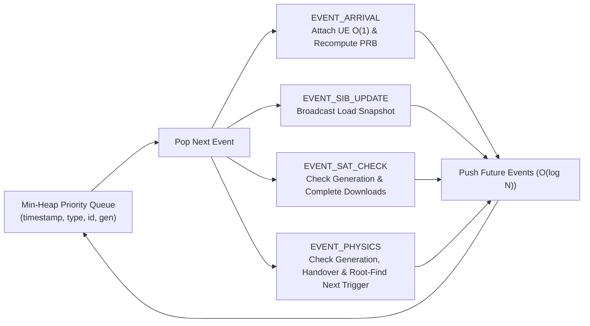

# LEO Event-Driven Network Simulator

A high-performance, **Numba-accelerated discrete-event network simulator** in Python for evaluating handover and load-balancing baselines in Low Earth Orbit (LEO) satellite constellations.

> **Note:** This public repository provides the generic event-driven simulation framework and standard baseline policies (`BHO`, `Normal CHO`, `Load-Min`, `Load-Std`). Experimental and research-specific policies are excluded.

---

## Key Engineering Highlights

- **Event-Driven Architecture (`src/sim_engine.py`, `src/event_queue.py`)**
  - Models asynchronous state transitions (`EVENT_ARRIVAL`, `EVENT_SIB_UPDATE`, `EVENT_SAT_CHECK`, `EVENT_PHYSICS`) without fixed time-step polling.
  - **Array-Based Min-Heap Priority Queue**: Deterministic event ordering by `(timestamp, event_type, entity_id)` in `O(log N)`.
  - **Generation-Counter Lazy Invalidation**: Avoids expensive heap deletions when satellite loads or user channels change mid-flight.
  - **Intrusive Doubly Linked Lists**: `O(1)` user attachment/detachment per satellite (`link_ue` / `unlink_ue`).
- **High-Performance Computing (`Numba @njit` + Multiprocessing)**
  - Core simulation loops, orbital geometry, channel calculations, and root-finding triggers are JIT-compiled to native machine code via `@njit(cache=True)`.
  - `src/runner.py` dispatches multi-scale / multi-policy sweeps across CPU cores using `concurrent.futures.ProcessPoolExecutor` and auto-purges stale Numba inline caches on startup.
- **Spatial Visibility Pruning & Root-Finding (`src/orbit.py`, `src/handover_policy.py`)**
  - Precomputes a time-indexed visibility grid over a 1,584-satellite (72 x 22 Walker-Delta, 550 km altitude) constellation to prune out-of-view satellites.
  - Locates exact asynchronous handover and MCS transition timestamps using coarse forward scanning refined with binary search.

---

## Event-Driven Execution Flow



---

## Repository Structure

```text
├── main.py                      # CLI entry point
├── src/
│   ├── constants.py             # Constellation, RF link budget, traffic & policy IDs
│   ├── channel.py               # FSPL SINR & MCS spectral efficiency mapping
│   ├── orbit.py                 # Analytical Walker-Delta orbits & visibility pruning grid
│   ├── event_queue.py           # Array-based min-heap & O(1) doubly linked list
│   ├── resource_manager.py      # Equal-PRB allocation & completion event scheduling
│   ├── handover_policy.py       # Baseline handover metrics & binary-search trigger
│   ├── traffic.py               # Region-weighted Poisson UE arrival generator
│   ├── sim_engine.py            # @njit discrete-event simulation loop
│   └── runner.py                # ProcessPoolExecutor sweep runner & CSV/text reporter
└── tests/                       # Unit & end-to-end smoke tests (unittest)
```

---

## Included Baseline Policies

| ID | Name | Elevation Threshold | Description |
|---:|---|---:|---|
| `0` | `BHO` | 30° | Baseline Hard Handover (instantaneous SINR maximization, 0 dB margin) |
| `1` | `Normal CHO` | 30° | 3GPP-style Conditional Handover (SINR maximization, 3.0 dB margin) |
| `2` | `Load-Min` | 25° | Load-balancing handover minimizing connected users |
| `3` | `Load-Std` | 30° | Conservative load-aware handover (30° elevation constraint) |

---

## Quick Start

### 1. Install Dependencies

```bash
python -m venv .venv
# Windows: .venv\Scripts\activate
# Linux/macOS: source .venv/bin/activate
pip install -r requirements.txt
```

### 2. Run Unit & Smoke Tests

```bash
python -m unittest discover -s tests -v
```

### 3. Run Baseline Benchmark

```bash
# Quick 120s benchmark across selected traffic scales
python main.py --duration 120 --scales 0.25 0.5 --methods 0 1 2 3

# Full default benchmark (1500s across scales 0.25 to 1.5)
python main.py
```

Outputs are automatically written to `experiments/latest_run/summary.txt` and `experiments/latest_run/results.csv`.

#### Sample Output (`--duration 120 --scales 0.25 0.5`)

```text
Load Scale x0.5: 870 arrivals, target UEs = 68, offered load ~ 5.8 Gbps, T = 120s
Method         | Avg(Mbps) |  Edge10% |     HO |   HOF |   RLF | Drop | Block | Unfin |  HeapPk |    Evals | MaxEv/UE
--------------------------------------------------------------------------------------------------------------------
BHO            |     48.13 |    15.46 |     36 |     0 |     0 |    0 |     0 |    11 |     893 |     1596 |        5
Normal CHO     |    147.83 |     8.06 |      0 |     0 |     0 |    0 |     0 |    27 |     893 |     1252 |        3
Load-Min       |    141.76 |    11.11 |     17 |     0 |     6 |    0 |     0 |    15 |    9743 |    36126 |      125
Load-Std       |    168.22 |    27.28 |     19 |     0 |     0 |    0 |     0 |     5 |   10079 |    29155 |       82
```

---

## 概要（日本語）

本リポジトリは、LEO（低軌道）衛星ネットワークにおけるハンドオーバー・負荷分散のベースライン手法を比較評価するための、**Numba（`@njit`）対応・イベント駆動型ネットワークシミュレータ基盤**です。

- **イベント駆動コア設計**：配列ベースの最小ヒープ（`O(log N)`）、世代番号による無効イベントの遅延破棄、双方向連結リストによる `O(1)` 端末収容管理を実装しています。
- **並列ベンチマーク実行**：`ProcessPoolExecutor` によるマルチプロセス並列実行に対応し、結果の集計表（`summary.txt`）および `results.csv` を自動出力します。

---

## License

MIT License — see [LICENSE](LICENSE).
